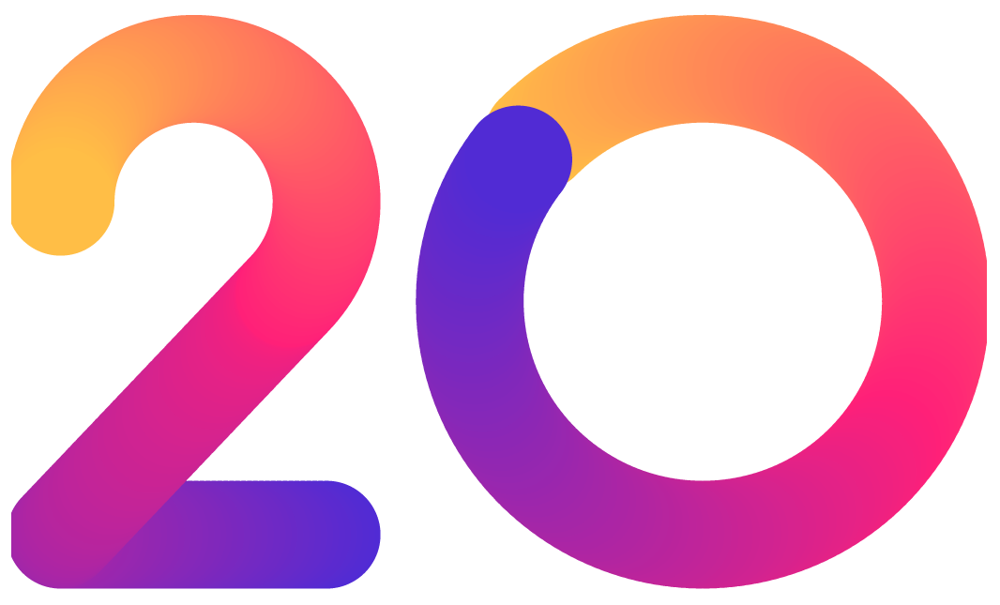

**English** | [简体中文](README.md)

# FreeKit

<h1 align="center"> .NET YEARS </h1>

**FreeKit** provides additional extensions for .NET Core.

     <a href="README.en.md">English</a> |  <a href="README.md">简体中文</a>

## Nuget Packages

| Package name| Version| Downloads|
| ------- | ------- | ------- |
| `IGeekFan.AspNetCore.Identity.FreeSql` |  |  |
| `IGeekFan.FreeKit`| | |    
| `IGeekFan.FreeKit.Extras`|                                         | |
| `IGeekFan.FreeKit.Modularity`|                                 | |
| `IGeekFan.FreeKit.Email`|                                 | |
| `IGeekFan.Localization.FreeSql`| | |
| `IGeekFan.Extensions.Diagnostics.HealthChecks.FreeSql`| | |
| `IGeekFan.AspNetCore.DataProtection.FreeRedis`| | |
| `IGeekFan.AspNetCore.DataProtection.FreeSql`| | |

## IGeekFan.AspNetCore.Identity.FreeSql

A FreeSql implementation of ASP.NET Core 6 Identity.
- See [IGeekFan.AspNetCore.Identity.FreeSql](https://igeekfan.cn/dotnetcore/freekit/AspNetCore.Identity.FreeSql.html) **documentation**

## IGeekFan.FreeKit

- AuditEntity: audit log entity
- Dependency: dependency-injection interfaces
- See [IGeekFan.FreeKit](https://igeekfan.cn/dotnetcore/freekit/Core.html) **documentation**

## IGeekFan.FreeKit.Extras

- FreeSql extensions + Autofac UnitOfWork
- FreeSql+AuditEntity
- Autofac+ITransientDependency+IScopedDependency+ISingletonDependency
- CaseQuery 
- Security: current-user information
- See [IGeekFan.FreeKit.Extras](https://igeekfan.cn/dotnetcore/freekit/Extras.html) **documentation**

## IGeekFan.FreeKit.Email

- MailKit-based email. See [IGeekFan.FreeKit.Email](https://igeekfan.cn/dotnetcore/freekit/Email.html) **documentation**

## IGeekFan.Localization.FreeSql

- Database-backed localization. See [IGeekFan.Localization.FreeSql](https://igeekfan.cn/dotnetcore/freekit/Localization.FreeSql.html) **documentation**

## IGeekFan.FreeKit.Modularity

- Modular monolith support. See [IGeekFan.FreeKit.Modularity](https://igeekfan.cn/dotnetcore/freekit/Modularity.html) **documentation**
